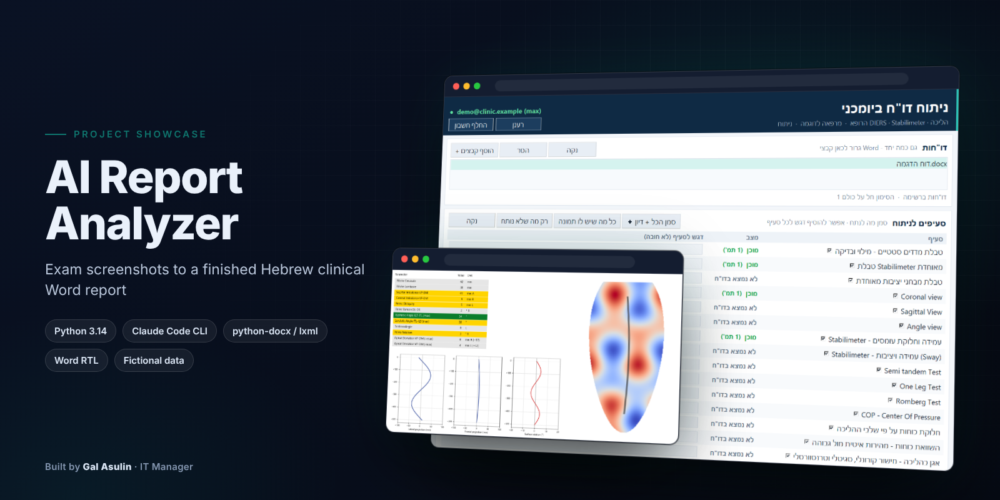
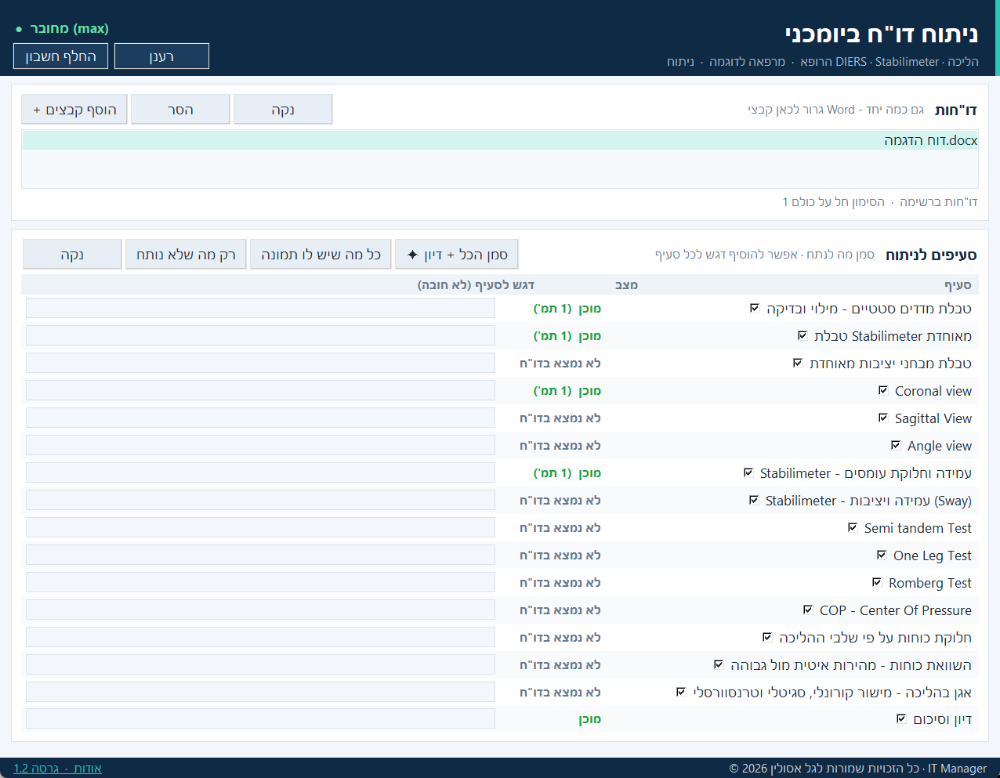
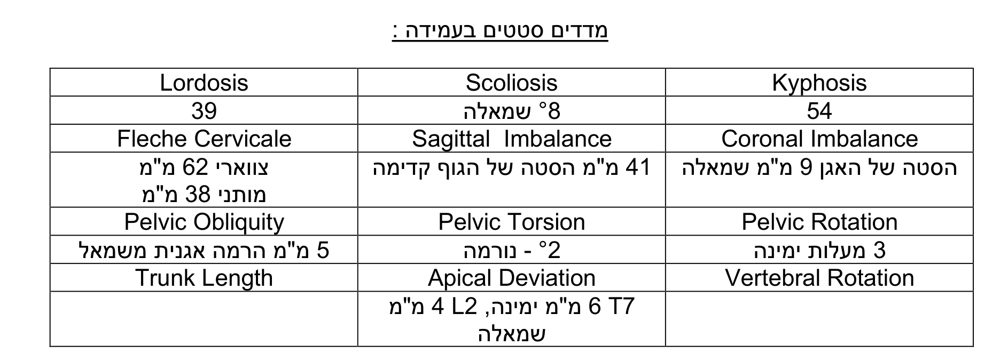
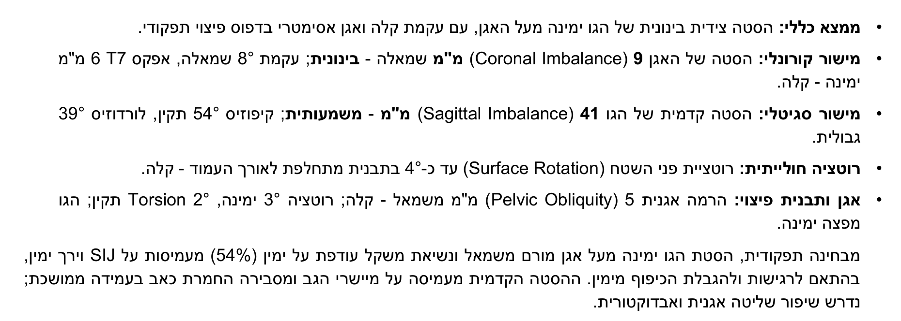
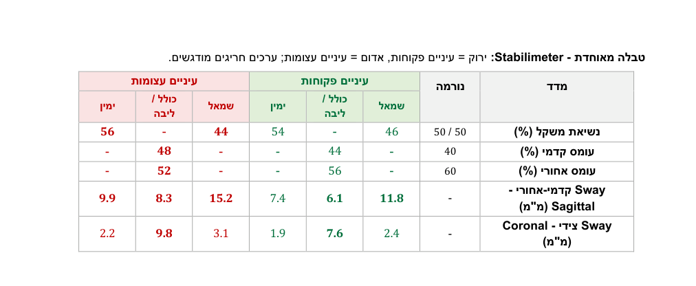
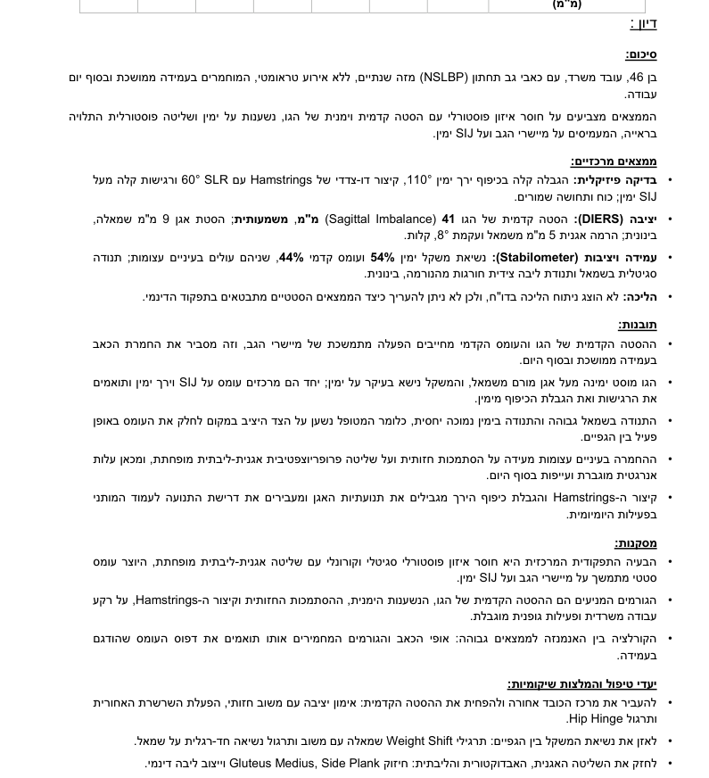
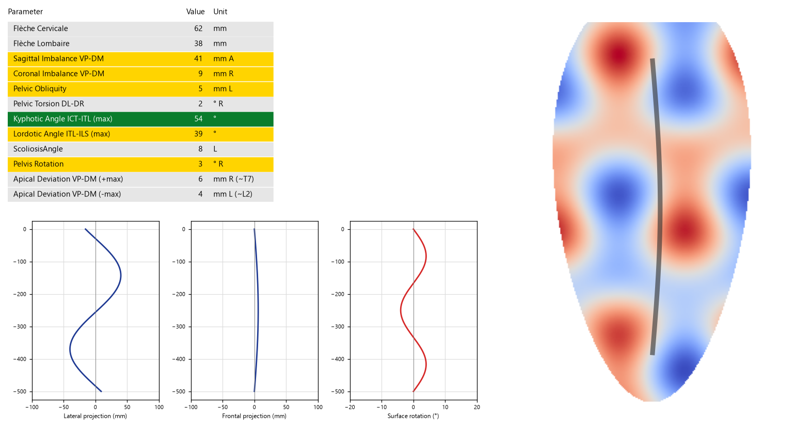
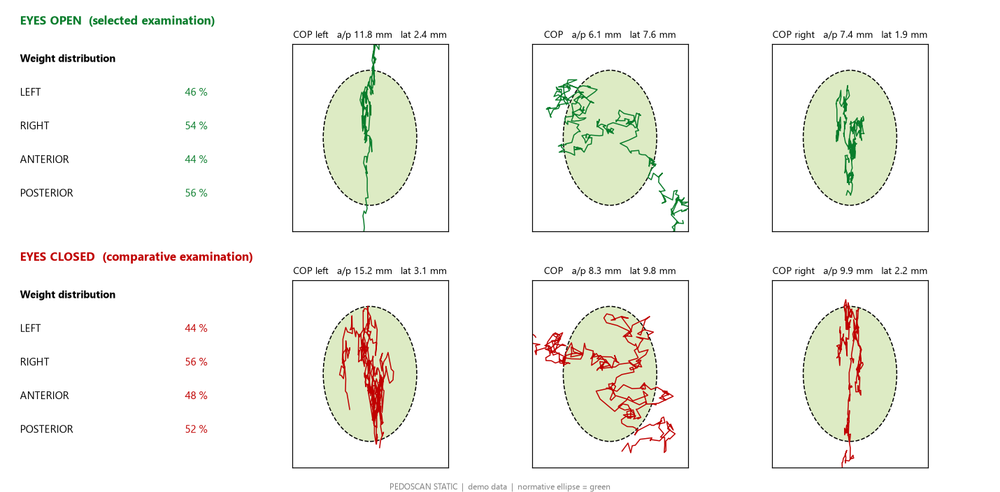
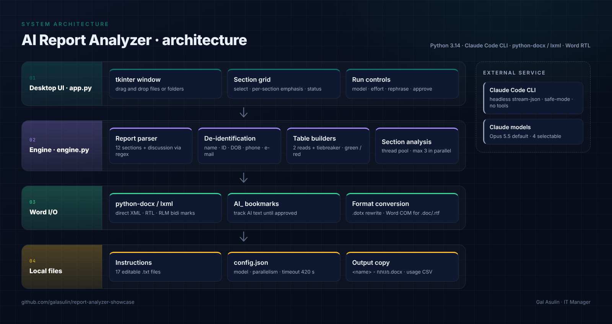
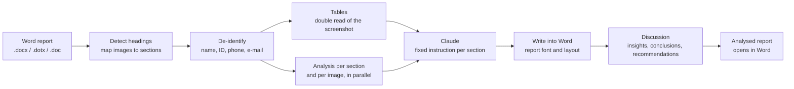

<p align="center"><a href="https://galasulin.github.io/report-analyzer-showcase/"></a></p>

<div align="center">

# AI Report Analyzer · ניתוח דו"ח ביומכני

**כלי שולחני ל-Windows שהופך צילומי בדיקות יציבה והליכה לדו"ח Word קליני מלא בעברית, בעזרת Claude.**

🇬🇧 [English](README.md) · 🇮🇱 [עברית](README.he.md)


[**דמו חי**](https://galasulin.github.io/report-analyzer-showcase/) · [מסכים](#מסכים) · [ארכיטקטורה](#ארכיטקטורה) · [טכנולוגיה](#פרמטרים-טכניים)

</div>

---

<div dir="rtl" align="right">

> [!IMPORTANT]
> כל הנתונים, השמות והצילומים במאגר הזה **בדיוניים** ונוצרו לצורך הדגמה בלבד. אין כאן מידע על מטופלים אמיתיים.

## במבט מהיר

| | |
|---|---|
| **סוג** | כלי שולחני ל-Windows ‏(tkinter) למעבדת ביומכניקה וניתוח הליכה |
| **סטטוס** | פיילוט במרפאה |
| **סטאק** | Python 3.14 · ‏python-docx / lxml · ‏Pillow · ‏tkinter + tkinterdnd2 · ‏Claude Code CLI |
| **התפקיד שלי** | עיצוב מוצר ופיתוח |
| **דמו חי** | [הזרימה, לפני/אחרי וארכיטקטורה](https://galasulin.github.io/report-analyzer-showcase/) (נתונים בדיוניים) |
| **שפות** | ממשק ודו"ח בעברית; עמוד הדמו בעברית ובאנגלית |

## מסכים

<table>
  <tr>
    <td width="33%"><a href="docs/images/app.png"></a><br><sub><b>התוכנה</b> · דו"חות, סעיפים, מודל ועומק חשיבה, הרצה</sub></td>
    <td width="33%"><a href="docs/images/report_table.png"></a><br><sub><b>טבלת המדדים</b> · מולאה מצילום ה-DIERS</sub></td>
    <td width="33%"><a href="docs/images/report_coronal.png"></a><br><sub><b>ניתוח קליני</b> · נכתב מתחת לתמונת ה-Coronal</sub></td>
  </tr>
  <tr>
    <td width="33%"><a href="docs/images/report_stab_table.png"></a><br><sub><b>טבלת Stabilimeter מאוחדת</b> · עיניים פקוחות / עצומות, בצבעים</sub></td>
    <td width="33%"><a href="docs/images/report_discussion.png"></a><br><sub><b>דיון</b> · ממצאים, תובנות, מסקנות ויעדי שיקום</sub></td>
    <td width="33%"><a href="docs/images/demo_diers_coronal.png"></a><br><sub><b>קלט</b> · צילום DIERS קורונלי בדיוני</sub></td>
  </tr>
  <tr>
    <td width="33%"><a href="docs/images/demo_pedoscan.png"></a><br><sub><b>קלט</b> · צילום יציבות Pedoscan בדיוני</sub></td>
    <td></td><td></td>
  </tr>
</table>

דו"ח הדגמה בדיוני, לפני ואחרי הניתוח, נמצא בתיקייה [`demo/`](demo/) (קובצי `.docx` ו-PDF של הגרסה המנותחת).

## מה זה

**לפני.** הרופא מקבל כמה מטופלים חדשים ביום. לכל מטופל יש כ-15 צילומי בדיקות, ומכל אחד צריך להעתיק ידנית מספרים לטבלה ולכתוב ניתוח קליני. זו עבודה של שעה ויותר לדו"ח, עם סיכון לטעויות העתקה (צד, ערך, כיוון).

**אחרי.** גוררים את הדו"ח לחלון ולוחצים "הרץ ניתוח". כעבור כמה דקות נפתח ב-Word דו"ח מלא: טבלאות ממולאות, ניתוח אחיד לכל סעיף ודיון מסכם. הרופא עובר ומאשר.

הרופא ממלא את הדו"ח כרגיל ומדביק את צילומי הבדיקות מ-DIERS (סריקות עמוד שדרה), Stabilimeter / Pedoscan (יציבה) ו-Pedogait (הליכה). הכל נכתב ישירות לתוך אותו קובץ Word, מימין לשמאל, בגופן של הדו"ח.

## יכולות מרכזיות

| | |
|---|---|
| **גרירה ושחרור** | גוררים קובץ, כמה קבצים או תיקייה שלמה לכל מקום בחלון |
| **כל פורמט Word** | ‎`.docx`, ‏`.dotx`, ‏`.doc`, ‏`.docm`, ‏`.dotm`, ‏`.rtf`; קובץ שאינו `.docx` מומר אוטומטית לעותק לניתוח |
| **בחירת סעיפים** | סימון מה לנתח, דגש אישי לכל סעיף, "סמן הכל + דיון" |
| **בחירת מודל** | Claude Opus 5.5 / Fable 5.1 / Sonnet 5.5 / Opus 5, ועומק חשיבה (גבוה, מקסימלי, בינוני) |
| **טבלאות מאוחדות** | Stabilimeter (ימין/שמאל × פקוחות/עצומות) ומבחני יציבות, בצבעי ירוק/אדום |
| **מילוי ותיקון אוטומטי** | ערכים בטבלה מוזנים ומתוקנים לפי הצילום, עם אימות בקריאה כפולה |
| **ניסוח מחדש** | קצר יותר / מפורט יותר / פשוט יותר, בלי לשנות ממצאים |
| **אישור טקסט** | נעילת טקסט שהרופא אישר, כך שהרצה חוזרת לא תדרוס אותו |
| **בדיקה לפני הרצה** | התרעה על סעיף בלי תמונה, כותרת חסרה או דו"ח בלי טקסט קליני |
| **הוראות ניתנות לעריכה** | קובץ טקסט לכל סעיף; הרופא משנה את הסגנון והתוכן בלי קוד |
| **יומן שימוש** | תאריך, מספר סעיפים, מודל ומשך, בלי פרטי מטופלים |

**איך דו"ח מעובד**

1. **זיהוי מבנה.** התוכנה מזהה את כותרות הדו"ח (Coronal / Sagittal / Angle view, ‏Stabilimeter, ‏Semi Tandem, ‏One Leg, ‏Romberg, ‏COP, חלוקת כוחות, אגן בהליכה, דיון) ומשייכת כל צילום לכותרת שמעליו.
2. **התממה.** לפני שליחה מוסרים שם, ת.ז, תאריך לידה, טלפון ומייל. שם הקובץ לא נשלח.
3. **טבלאות.** טבלת המדדים הסטטיים מתמלאת מצילומי ה-DIERS. כל צילום נקרא **פעמיים באופן בלתי תלוי** (כולל חיתוך מוגדל של טבלת הפרמטרים), ורק ערך ששתי הקריאות הסכימו עליו נכנס לדו"ח; במקרה של מחלוקת, קריאה שלישית מכריעה.
4. **ניתוח.** כל סעיף מנותח לפי **הוראה קבועה** שהרופא הגדיר (מה לקרוא, אילו נורמות, מה המשמעות הקלינית), ולא בצ'אט חופשי. כמה תמונות תחת אותה כותרת מקבלות ניתוח נפרד כל אחת.
5. **כתיבה.** הטקסט נכתב בתוך ה-Word בעברית מימין לשמאל, בגופן ובגודל של הדו"ח, עם תבליטים מסודרים. ערכים כמו `L2 11 מ"מ ימינה` מוצגים בסדר הנכון בעזרת סימני כיוון בלתי נראים.
6. **דיון.** בסוף נכתב דיון אינטגרטיבי: סיכום, ממצאים מרכזיים, תובנות, מסקנות ויעדי טיפול שיקומיים.

## ארכיטקטורה



`app.py` הוא חלון ה-tkinter: רשימת קבצים עם גרירה ושחרור, טבלת סעיפים, בחירת מודל ועומק חשיבה, ו-thread רקע שמזרים שורות יומן לממשק. `engine.py` עושה את העבודה. אובייקט `Report` פותח את המסמך עם python-docx, מאתר את טווחי הסעיפים לפי הביטויים הרגולריים ב-`sections.json`, אוסף את הפרטים המזהים מהטבלה הראשונה ומוחק אותם מכל פרומפט. הטבלאות רצות ראשונות (מדדים סטטיים, Stabilimeter, מבחני יציבות) ונשמרות, כך שהסעיפים הבאים רואים אותן; אחר כך סעיפי התמונות רצים במקביל דרך thread pool, וכל קריאה עוברת ל-Claude Code CLI במצב headless ‏`stream-json` עם התמונות מצורפות כ-base64. התוצאות נכתבות מסוף המסמך לתחילתו כדי שהמיקומים לא ישתבשו, הדיון רץ אחרון על הטקסט הגמור, והפלט נשמר כעותק חדש `- מנותח.docx`.

### זרימה

<div dir="ltr" align="left">



</div>

## פרמטרים טכניים

| פרמטר | ערך |
|---|---|
| שפה וסביבת ריצה | Python 3.14 על Windows 11 |
| קוד מקור | 3 מודולים ב-`src/` ‏(`app.py` ‏558 שורות, `engine.py` ‏1,320, ‏`tools.py` ‏74) ועוד 3 סקריפטים ליצירת חומרי הדגמה ב-`tools/` ‏(224 שורות) |
| ספריות | tkinter + tkinterdnd2 (ממשק וגרירה), python-docx / lxml (עבודה ישירה על ה-XML של Word, כולל RTL), Pillow (הקטנה וחיתוך מוגדל), PyInstaller (קובץ הפעלה יחיד), Word COM (המרות ובדיקות) |
| סעיפי הדו"ח | 12 סעיפים שמזוהים בביטוי רגולרי ב-`sections.json` ועוד דיון; 3 בוני טבלאות (מדדים סטטיים, Stabilimeter מאוחדת, מבחני יציבות) |
| הוראות | 17 קובצי טקסט ב-`src/הוראות/` (אחד לכל סעיף וטבלה, קובץ כללים כללי וקובץ לדיון) |
| טבלת מדדים סטטיים | 14 פרמטרים (Kyphosis, ‏Scoliosis, ‏Lordosis, ‏Coronal / Sagittal Imbalance, ‏Pelvic Rotation / Torsion / Obliquity, ‏Vertebral Rotation ועוד); 2 מהם שיפוט קליני של הרופא ונבדקים בלבד; 3 שורות נוספות אם חסרות |
| אימות מספרים | 2 קריאות בלתי תלויות ובמקביל לכל טבלה, קריאה שלישית רק במחלוקת; הערכים מנורמלים לפני ההשוואה |
| קריאה למודל | `claude -p --input-format stream-json --output-format stream-json --safe-mode --strict-mcp-config --tools "" --no-session-persistence --model … --effort …` עם system prompt קבוע |
| מודלים | 4 לבחירה (Opus 5.5 ברירת מחדל, Fable 5.1, ‏Sonnet 5.5, ‏Opus 5); עומק חשיבה `high` (ברירת מחדל), `xhigh`, ‏`medium` |
| מקביליות ומגבלות | `max_parallel` ‏3 workers, ‏`timeout_sec` ‏420 לקריאה, עד 2 דוגמאות סגנון לכל סעיף (`config.json`) |
| תמונות | PNG / JPEG נשלחות כ-base64; מוקטנות לצלע ארוכה של 1568 פיקסלים כשהן גדולות יותר או בפורמט אחר |
| פורמטי קלט | `.docx` ישירות; `.dotx` מומר בשכתוב ה-content type של החבילה; `.doc` / `.docm` / `.dotm` / `.rtf` מומרים דרך Word COM ב-PowerShell |
| פלט | עותק חדש `<שם> - מנותח.docx`; טקסט שנכתב על ידי ה-AI מסומן ב-bookmarks עם קידומת `AI_` עד שמאשרים אותו |
| התממה | שורת הפרטים בטבלה הראשונה (שם, ת.ז, תאריך לידה, טלפון, מייל) ועוד ביטויים רגולריים למייל, לטלפון ישראלי ולמספר בן 9 ספרות |
| יומן שימוש | קובץ CSV מקומי: תאריך, שעה, פעולה, סעיפים, מודל, שניות, שגיאות; בלי שמות קבצים |
| אתר הדמו | `docs/index.html` ‏(596 שורות), עברית ואנגלית דרך `?lang=en` |

## החלטות הנדסיות

- **Claude Code CLI במצב headless במקום מפתח API** ← הכלי רץ על המחשב במרפאה תחת מנוי אישי קיים, עם `--safe-mode`, בלי כלים ובלי שמירת session. המחיר: ה-CLI חייב להיות מותקן ומחובר; האפליקציה בודקת את מצב ההתחברות ופותחת חלון כניסה כשצריך.
- **עבודה ישירה על ה-XML של Word** ← python-docx ו-lxml כותבים לתוך המסמך של הרופא עצמו, כך שהגופן, הגודל, העימוד וה-RTL נשמרים. המחיר: את הכיווניות צריך לנהל ידנית, עם סימני RLM בלתי נראים לערכים כמו `L2 11 מ"מ`.
- **שתי קריאות בלתי תלויות וקריאה מכריעה** ← מספר נכתב רק כששתי קריאות מסכימות עליו, וזה מנטרל את רוב טעויות ההעתקה של צד, ערך וכיוון. המחיר: שתיים עד שלוש קריאות למודל לכל טבלה במקום אחת.
- **הוראה קבועה וניתנת לעריכה לכל סעיף** ← כל דו"ח בנוי באותו מבנה ועם אותן נורמות, והרופא משנה ניסוחים בקובץ טקסט. המחיר: סעיף חדש בדו"ח דורש גם ביטוי רגולרי ב-`sections.json` וגם קובץ הוראות.
- **לא נוגעים במקור; טקסט AI מסומן עד לאישור** ← כל הרצה כותבת עותק, וה-bookmarks מאפשרים להרצה חוזרת להחליף רק טקסט AI שעוד לא אושר. המחיר: הרופא צריך לאשר במפורש כדי לנעול טקסט.
- **הדיון רץ אחרון** ← הוא קורא את הניתוחים שכבר נכתבו למסמך, כך שהסיכום אינטגרטיבי ולא ניחוש נפרד. המחיר: הוא לא יכול לרוץ במקביל לסעיפים.

## מבנה הריפו

<div dir="ltr" align="left">

```text
report-analyzer-showcase/
├── src/
│   ├── app.py              # tkinter window + drag and drop, styling, background run
│   ├── engine.py           # the engine: Word reading, de-identification, Claude, writing, tables
│   ├── tools.py            # learn style examples from finished reports, make a clean copy for testing
│   ├── sections.json       # heading detection in the report
│   ├── config.example.json # model, effort, parallelism
│   ├── icon.ico · icon.png
│   └── הוראות/             # fixed, editable instruction per section
├── tools/                  # generate the demo material (fictional screenshots and report)
├── demo/                   # demo report before and after analysis (.docx + .pdf)
├── docs/
│   ├── index.html          # live demo page (GitHub Pages)
│   └── images/             # screenshots
└── LICENSE
```

</div>

## פרטיות והיקף

- **התממה לפני שליחה.** פרטים מזהים מוסרים מהטקסט; הצילומים עצמם אינם כוללים פרטי מטופל.
- **בלי שרת ביניים.** התוכנה רצה על המחשב במרפאה ומשתמשת ב-Claude Code עם מנוי אישי. אין מסד נתונים ואין העלאה לענן של הקבצים עצמם.
- **המקור לא משתנה.** כל הרצה יוצרת עותק `- מנותח.docx`.
- **אימון מודלים כבוי.** ההגדרה "Help improve Claude" כבויה בחשבון.
- **קבצים מקומיים נשארים מקומיים.** `config.json`, יומן השימוש ויומן השגיאות מוחרגים מהריפו.
- **נתונים בדיוניים בלבד.** כל השמות, הנתונים והצילומים כאן נוצרו לצורך הדגמה.

## רישיון

© 2026 כל הזכויות שמורות לגל אסולין · IT Manager. פותח ועוצב על ידי גל אסולין. המאגר מתפרסם להדגמה בלבד; אין להעתיק, להפיץ או לשנות ללא אישור בכתב. ראו [LICENSE](LICENSE).

</div>

---

<div align="center"><b>Built by <a href="https://github.com/galasulin">Gal Asulin</a>, IT Manager</b></div>
