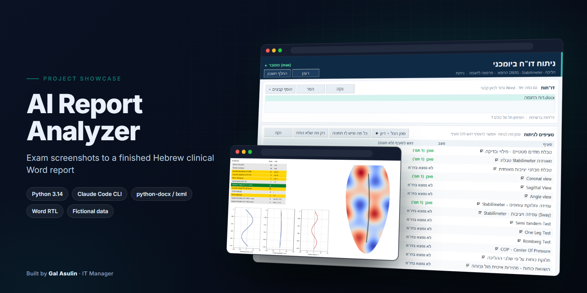
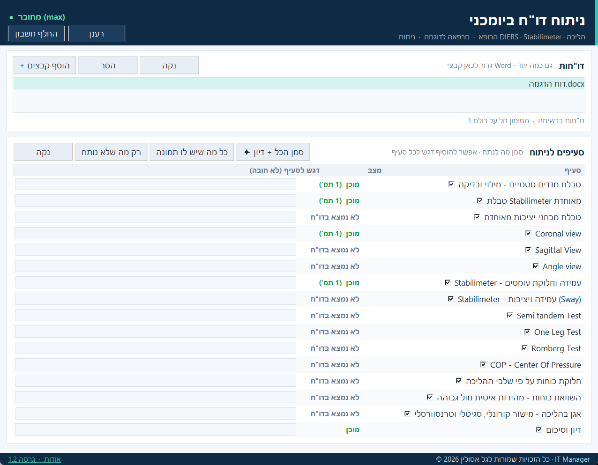
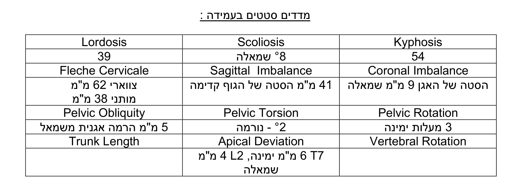
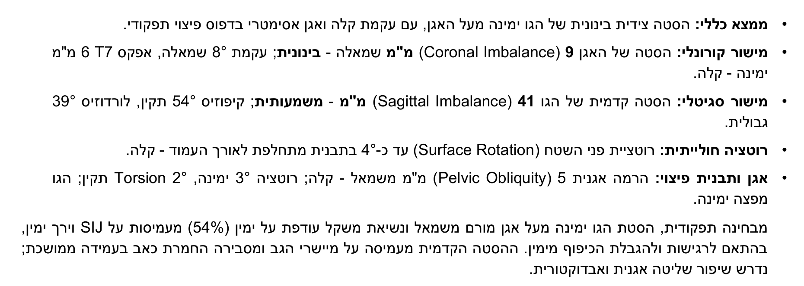
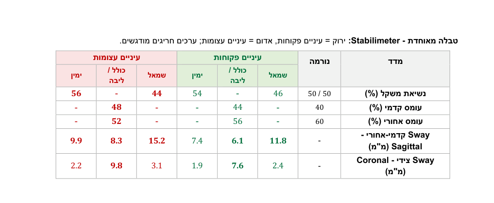
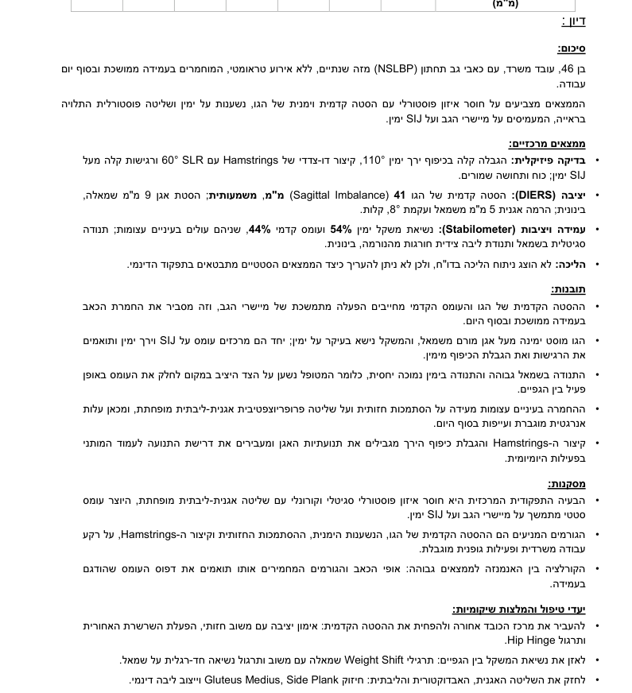
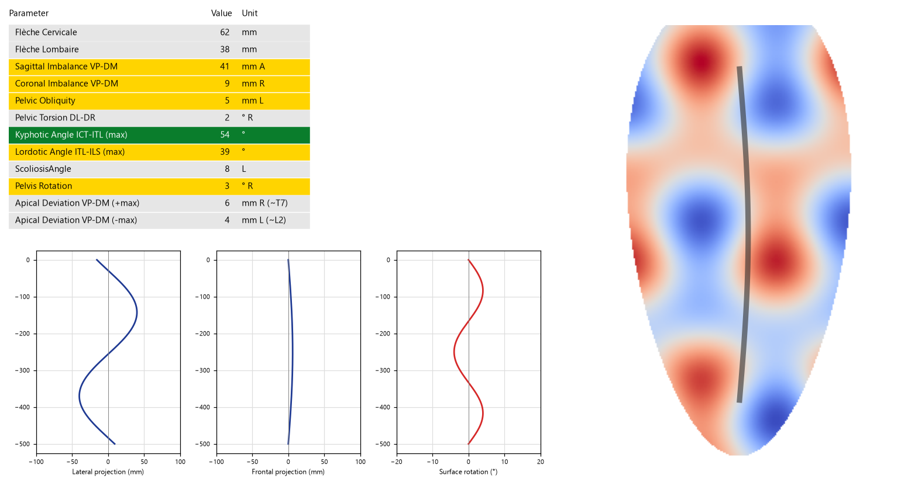
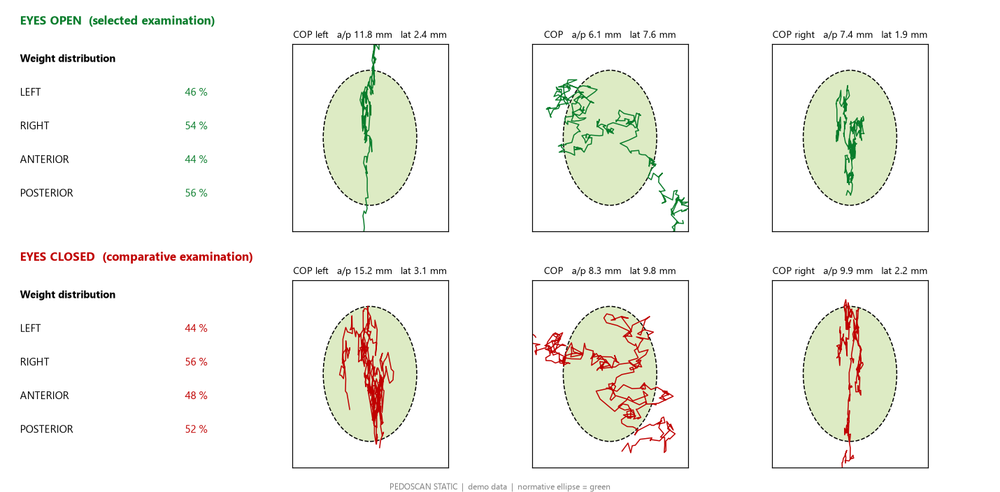
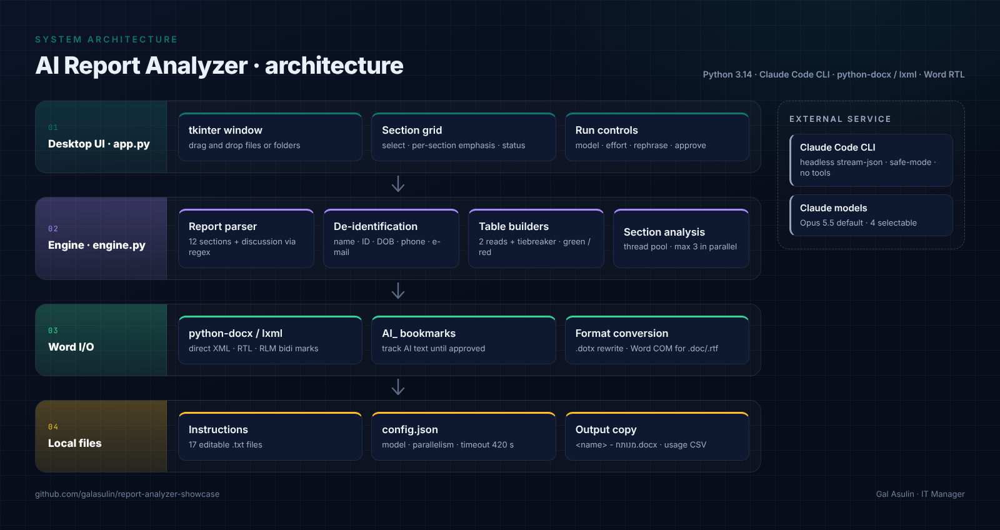
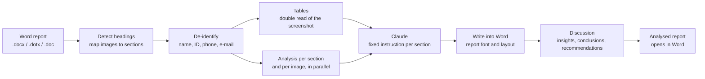

<p align="center"><a href="https://galasulin.github.io/report-analyzer-showcase/?lang=en"></a></p>

<div align="center">

# AI Report Analyzer

**A Windows desktop tool that turns posture and gait exam screenshots into a finished Hebrew clinical Word report with Claude.**

🇬🇧 [English](README.md) · 🇮🇱 [עברית](README.he.md)


[**Live demo**](https://galasulin.github.io/report-analyzer-showcase/?lang=en) · [Screens](#screens) · [Architecture](#architecture) · [Tech](#technical-parameters)

</div>

> [!IMPORTANT]
> All names, data and images in this repository are **fictional** and were created for demonstration purposes only. There is no real patient information here.

---

## At a glance

| | |
|---|---|
| **Type** | Windows desktop tool (tkinter) for a biomechanics / gait-analysis lab |
| **Status** | Pilot in clinic |
| **Stack** | Python 3.14 · python-docx / lxml · Pillow · tkinter + tkinterdnd2 · Claude Code CLI |
| **My role** | Product design and development |
| **Live demo** | [Flow, before/after and architecture](https://galasulin.github.io/report-analyzer-showcase/?lang=en) (fictional data) |
| **Languages** | Hebrew UI and report output; demo page in Hebrew and English |

## Screens

<table>
  <tr>
    <td width="33%"><a href="docs/images/app.png"></a><br><sub><b>The tool</b> · reports, sections, model and effort, run</sub></td>
    <td width="33%"><a href="docs/images/report_table.png"></a><br><sub><b>Measurements table</b> · filled from the DIERS screenshot</sub></td>
    <td width="33%"><a href="docs/images/report_coronal.png"></a><br><sub><b>Clinical analysis</b> · written under the Coronal image</sub></td>
  </tr>
  <tr>
    <td width="33%"><a href="docs/images/report_stab_table.png"></a><br><sub><b>Unified Stabilimeter table</b> · eyes open / closed, colour-coded</sub></td>
    <td width="33%"><a href="docs/images/report_discussion.png"></a><br><sub><b>Discussion</b> · findings, insights, conclusions, rehab goals</sub></td>
    <td width="33%"><a href="docs/images/demo_diers_coronal.png"></a><br><sub><b>Input</b> · fictional DIERS coronal screenshot</sub></td>
  </tr>
  <tr>
    <td width="33%"><a href="docs/images/demo_pedoscan.png"></a><br><sub><b>Input</b> · fictional Pedoscan balance screenshot</sub></td>
    <td></td><td></td>
  </tr>
</table>

A fictional report before and after analysis is in [`demo/`](demo/) (`.docx`, plus a PDF of the analysed version).

## What it is

**Before.** The physician sees several new patients a day. Each patient has about 15 exam screenshots, and from each one numbers have to be copied by hand into a table and a clinical analysis written. That is an hour or more per report, with a real risk of copy errors (side, value, direction).

**After.** Drag the report into the window and click "Run analysis". A few minutes later Word opens a complete report: tables filled in, a consistent analysis for every section and a closing discussion. The physician reviews and approves.

The physician fills the Word report as usual and pastes the screenshots from DIERS (spine scans), Stabilimeter / Pedoscan (balance) and Pedogait (gait). Everything is written straight into the same Word file, right-to-left, in the report's own font.

## Key capabilities

| | |
|---|---|
| **Drag and drop** | Drop a file, several files or a whole folder anywhere on the window |
| **Any Word format** | `.docx`, `.dotx`, `.doc`, `.docm`, `.dotm`, `.rtf`; non-`.docx` files are converted to a working copy automatically |
| **Section selection** | Choose what to analyse, add a personal emphasis per section, "select all + discussion" |
| **Model choice** | Claude Opus 5.5 / Fable 5.1 / Sonnet 5.5 / Opus 5, plus thinking effort (high, max, medium) |
| **Unified tables** | Stabilimeter (right / left × eyes open / closed) and balance tests, colour-coded green / red |
| **Auto fill and correction** | Table values are filled and corrected from the screenshot, verified by double reading |
| **Rephrase** | Shorter / more detailed / simpler, without changing findings |
| **Approve text** | Locks text the physician approved, so a re-run never overwrites it |
| **Pre-run check** | Warns about a section without an image, a missing heading, or a report without clinical text |
| **Editable instructions** | One text file per section; the physician changes style and content without code |
| **Usage log** | Date, number of sections, model and duration, with no patient details |

**How a report is processed**

1. **Structure detection.** The tool finds the report headings (Coronal / Sagittal / Angle view, Stabilimeter, Semi Tandem, One Leg, Romberg, COP, force distribution, pelvis in gait, discussion) and maps each screenshot to the heading above it.
2. **De-identification.** Name, ID number, date of birth, phone and e-mail are removed before anything is sent. The file name is never sent.
3. **Tables.** The static-measurements table is filled from the DIERS screenshots. Each screenshot is read **twice, independently** (including a zoomed crop of the parameter table), and only a value both reads agree on is written; on disagreement a third read decides.
4. **Analysis.** Each section is analysed under a **fixed instruction** the physician defined (what to read, which norms, what the clinical meaning is), not a free chat. Several images under one heading get a separate analysis each.
5. **Writing.** Text is written into Word in right-to-left Hebrew, in the report's font and size, with tidy bullets. Values such as `L2 11 mm to the right` keep the correct order thanks to invisible direction marks.
6. **Discussion.** The run ends with an integrative discussion: summary, key findings, insights, conclusions and rehabilitation goals.

## Architecture



`app.py` is the tkinter window: file list with drag and drop, section grid, model and effort pickers, and a background worker thread that streams log lines to the UI. `engine.py` does the work. A `Report` object opens the document with python-docx, finds section ranges with the regex patterns in `sections.json`, collects identity values from the first table and scrubs them from every prompt. Tables run first (statics, Stabilimeter, balance) and are saved so later sections see them; image sections then run in parallel through a thread pool, each call going to the Claude Code CLI in headless `stream-json` mode with images attached as base64. Results are written back from the end of the document to the start so positions stay valid, the discussion runs last over the finished text, and the output is saved as a new `- מנותח.docx` copy.

### Flow



## Technical parameters

| Parameter | Value |
|---|---|
| Language and runtime | Python 3.14 on Windows 11 |
| Source | 3 modules in `src/` (`app.py` 558 lines, `engine.py` 1,320, `tools.py` 74) plus 3 demo-asset scripts in `tools/` (224 lines) |
| Libraries | tkinter + tkinterdnd2 (UI, drag and drop), python-docx / lxml (direct Word XML, RTL), Pillow (resizing, zoomed crops), PyInstaller (single executable), Word COM (conversions and checks) |
| Report sections | 12 detected by regex in `sections.json` + discussion; 3 table builders (static measurements, unified Stabilimeter, balance tests) |
| Instructions | 17 plain-text files in `src/הוראות/` (one per section and table, a general rules file and the discussion) |
| Static-measurements table | 14 parameters (Kyphosis, Scoliosis, Lordosis, Coronal / Sagittal Imbalance, Pelvic Rotation / Torsion / Obliquity, Vertebral Rotation and more); 2 are check-only physician judgements; 3 rows added if missing |
| Number verification | 2 independent parallel reads per table, a 3rd read only on disagreement; values normalised before comparison |
| Model call | `claude -p --input-format stream-json --output-format stream-json --safe-mode --strict-mcp-config --tools "" --no-session-persistence --model … --effort …` with a fixed system prompt |
| Models | 4 selectable (Opus 5.5 default, Fable 5.1, Sonnet 5.5, Opus 5); effort `high` (default), `xhigh`, `medium` |
| Concurrency and limits | `max_parallel` 3 workers, `timeout_sec` 420 per call, up to 2 style examples per section (`config.json`) |
| Images | PNG / JPEG sent as base64; downscaled to a 1568 px long edge when larger or in another format |
| Input formats | `.docx` direct; `.dotx` converted by rewriting the package content type; `.doc` / `.docm` / `.dotm` / `.rtf` converted through Word COM in PowerShell |
| Output | A new `<name> - מנותח.docx`; AI-written text is tracked with `AI_` bookmarks until approved |
| De-identification | Identity row of the first table (name, ID, date of birth, phone, e-mail) plus regex for e-mail, Israeli phone numbers and 9-digit IDs |
| Usage log | Local CSV: date, time, action, sections, model, seconds, errors; no file names |
| Demo site | `docs/index.html` (596 lines), Hebrew and English via `?lang=en` |

## Engineering decisions

- **Claude Code CLI in headless mode instead of a raw API key** → the tool runs on the clinic PC under an existing personal subscription, with `--safe-mode`, no tools and no session persistence. Trade-off: the CLI must be installed and signed in; the app checks auth status and opens a login window when needed.
- **Edit the Word XML directly** → python-docx and lxml write into the physician's own document, so font, size, layout and RTL survive. Trade-off: bidi has to be handled by hand, with invisible RLM marks for values like `L2 11 mm`.
- **Double independent reads with a tiebreaker** → a number is written only when two reads agree, which removes most transcription errors on side, value and direction. Trade-off: two to three model calls per table instead of one.
- **Fixed, editable instruction per section** → every report follows the same structure and norms, and the physician changes wording in a text file. Trade-off: a new report section needs both a regex in `sections.json` and an instruction file.
- **Never touch the original; mark AI text until approved** → each run writes a copy, and bookmarks let a re-run replace only unapproved AI text. Trade-off: the physician has to approve explicitly to lock text.
- **Discussion runs last** → it reads the analyses already written into the document, so the summary is integrative rather than a separate guess. Trade-off: it cannot run in parallel with the sections.

## Repository layout

```text
report-analyzer-showcase/
├── src/
│   ├── app.py              # tkinter window + drag and drop, styling, background run
│   ├── engine.py           # the engine: Word reading, de-identification, Claude, writing, tables
│   ├── tools.py            # learn style examples from finished reports, make a clean copy for testing
│   ├── sections.json       # heading detection in the report
│   ├── config.example.json # model, effort, parallelism
│   ├── icon.ico · icon.png
│   └── הוראות/             # fixed, editable instruction per section
├── tools/                  # generate the demo material (fictional screenshots and report)
├── demo/                   # demo report before and after analysis (.docx + .pdf)
├── docs/
│   ├── index.html          # live demo page (GitHub Pages)
│   └── images/             # screenshots
└── LICENSE
```

## Privacy & scope

- **De-identification before sending.** Identifying details are removed from the text; the screenshots themselves contain no patient details.
- **No intermediate server.** The tool runs on the clinic PC and uses Claude Code with a personal subscription. There is no database and no cloud upload of the files themselves.
- **The original never changes.** Every run creates a `- מנותח.docx` copy.
- **Model training is off.** The "Help improve Claude" setting is turned off on the account.
- **Local files stay local.** `config.json`, the usage log and the error log are excluded from the repository.
- **Fictional data only.** All names, data and images in this repository were created for demonstration.

## License

© 2026 Gal Asulin, IT Manager. All rights reserved. Published for demonstration (showcase) purposes only; no permission is granted to use, copy, modify or distribute without prior written permission. See [LICENSE](LICENSE).

---

<div align="center"><b>Built by <a href="https://github.com/galasulin">Gal Asulin</a>, IT Manager</b></div>
