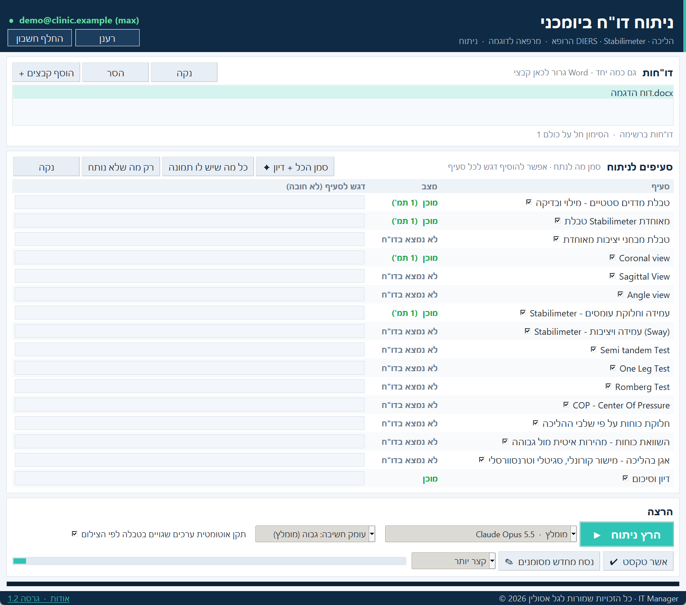
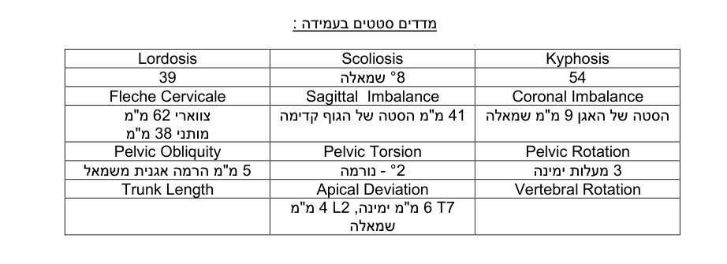
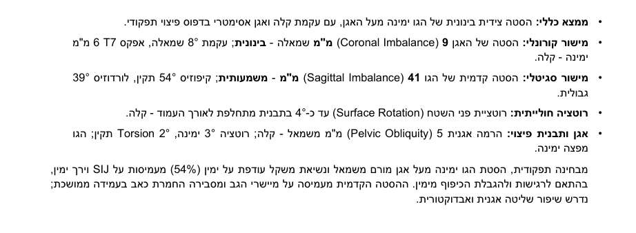
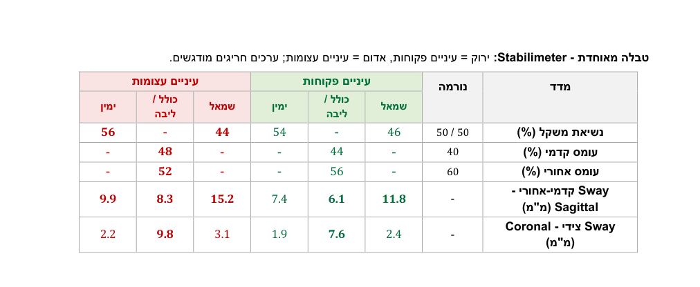
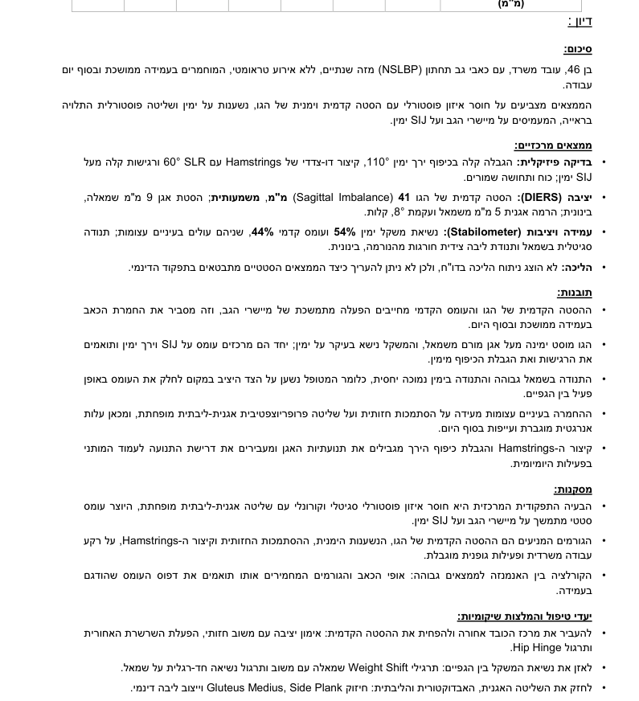
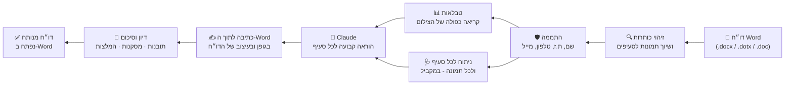

<div dir="rtl">

# 🦴 ניתוח דו"ח ביומכני — AI Report Analyzer

**כלי שולחני שהופך דו"ח Word של מעבדת יציבה והליכה לדו"ח קליני מלא - בלחיצה אחת.**
הרופא ממלא את הדו"ח כרגיל ומדביק את צילומי הבדיקות (DIERS, Stabilimeter, Pedogait). התוכנה קוראת כל צילום, ממלאת את טבלאות המדדים, כותבת ניתוח קליני מתחת לכל תמונה, ומסכמת הכל בדיון עם תובנות, מסקנות והמלצות שיקומיות - ישירות בתוך קובץ ה-Word, בעיצוב ובגופן של הדו"ח.


> ⚠️ כל הנתונים, השמות והצילומים במאגר הזה **בדיוניים** ונוצרו לצורך הדגמה בלבד. אין כאן מידע על מטופלים אמיתיים.

---

## 📸 צילומי מסך

### התוכנה


### הדו"ח אחרי הניתוח
| טבלת המדדים - מולאה מהצילום | ניתוח קליני מתחת לצילום |
|---|---|
|  |  |

| טבלה מאוחדת - עיניים פקוחות / עצומות | דיון וסיכום |
|---|---|
|  |  |

---

## 💡 הבעיה והפתרון

**לפני:** הרופא מקבל כמה מטופלים חדשים ביום. לכל מטופל יש כ-15 צילומי בדיקות, שמכל אחד צריך להעתיק ידנית מספרים לטבלה ולכתוב ניתוח קליני. עבודה של שעה ויותר לדו"ח, עם סיכון לטעויות העתקה (צד, ערך, כיוון).

**אחרי:** גוררים את הדו"ח לחלון, לוחצים "הרץ ניתוח", וכעבור כמה דקות נפתח ב-Word דו"ח מלא - טבלאות ממולאות, ניתוח אחיד לכל סעיף ודיון מסכם. הרופא רק עובר ומאשר.

---

## ⚙️ איך זה עובד



1. **זיהוי מבנה** - התוכנה מזהה את כותרות הדו"ח (Coronal / Sagittal / Angle view, Stabilimeter, Semi Tandem, One Leg, Romberg, COP, חלוקת כוחות, אגן בהליכה, דיון) ומשייכת כל צילום לכותרת שמעליו.
2. **התממה** - לפני שליחה מוסרים שם, ת.ז, תאריך לידה, טלפון ומייל. שם הקובץ לא נשלח.
3. **טבלאות** - טבלת המדדים הסטטיים מתמלאת מצילומי ה-DIERS. כל צילום נקרא **פעמיים באופן בלתי תלוי** (כולל חיתוך מוגדל של טבלת הפרמטרים), ורק ערך ששתי הקריאות הסכימו עליו נכנס לדו"ח; במקרה של מחלוקת - קריאה שלישית מכריעה.
4. **ניתוח** - כל סעיף מנותח לפי **הוראה קבועה** שהרופא הגדיר (מה לקרוא, אילו נורמות, מה המשמעות הקלינית) - לא צ'אט חופשי. כמה תמונות תחת אותה כותרת = ניתוח נפרד לכל תמונה.
5. **כתיבה** - הטקסט נכתב בתוך ה-Word בעברית מימין לשמאל, בגופן ובגודל של הדו"ח, עם תבליטים מסודרים. ערכים כמו `L2 11 מ"מ ימינה` מוצגים בסדר הנכון בעזרת סימני כיוון בלתי נראים.
6. **דיון** - בסוף נכתב דיון אינטגרטיבי: סיכום, ממצאים מרכזיים, תובנות, מסקנות ויעדי טיפול שיקומיים.

---

## ✨ יכולות

| | |
|---|---|
| 🖱️ **גרירה ושחרור** | גוררים קובץ, כמה קבצים או תיקייה שלמה לכל מקום בחלון |
| 📑 **כל פורמט Word** | ‎.docx, ‏.dotx, ‏.doc, ‏.docm - המרה אוטומטית לעותק לניתוח |
| 🎯 **בחירת סעיפים** | סימון מה לנתח, דגש אישי לכל סעיף, "סמן הכל + דיון" |
| 🤖 **בחירת מודל** | Claude Opus 5.5 / Fable 5.1 / Sonnet 5.5 / Opus 5 + עומק חשיבה |
| 📊 **טבלאות מאוחדות** | Stabilimeter (ימין/שמאל × פקוחות/עצומות) ומבחני יציבות - ירוק/אדום |
| 🔢 **מילוי ותיקון אוטומטי** | ערכים בטבלה מוזנים ומתוקנים לפי הצילום, עם אימות בקריאה כפולה |
| ✎ **ניסוח מחדש** | קצר יותר / מפורט יותר / פשוט יותר - בלי לשנות ממצאים |
| ✔ **אישור טקסט** | נעילת טקסט שהרופא אישר, כך שהרצה חוזרת לא תדרוס אותו |
| 🧾 **בדיקה לפני הרצה** | התרעה על סעיף בלי תמונה, כותרת חסרה, דו"ח בלי טקסט קליני |
| 📝 **הוראות ניתנות לעריכה** | קובץ טקסט לכל סעיף - הרופא משנה את הסגנון והתוכן בלי קוד |
| 📈 **יומן שימוש** | תאריך, מספר סעיפים, מודל ומשך - בלי פרטי מטופלים |

---

## 🛡️ פרטיות

- **התממה לפני שליחה** - פרטים מזהים מוסרים מהטקסט; הצילומים עצמם אינם כוללים פרטי מטופל.
- **ללא שרת ביניים** - התוכנה רצה על המחשב במרפאה ומשתמשת ב-Claude Code עם מנוי אישי. אין מסד נתונים, אין העלאה לענן של הקבצים עצמם.
- **המקור לא משתנה** - כל הרצה יוצרת עותק "‎- מנותח.docx".
- **אימון מודלים כבוי** - ההגדרה "Help improve Claude" כבויה בחשבון.

---

## 🗂️ מבנה הפרויקט

```
src/
├── app.py              # חלון התוכנה (tkinter + גרירה), עיצוב, הרצה ברקע
├── engine.py           # המנוע: קריאת Word, התממה, Claude, כתיבה, טבלאות
├── tools.py            # למידת סגנון מדו"חות קודמים, יצירת עותק נקי לבדיקות
├── sections.json       # זיהוי הכותרות בדו"ח
├── config.example.json # מודל, עומק חשיבה, מקביליות
└── הוראות/             # הוראה קבועה לכל סעיף - ניתנת לעריכה
tools/                  # יצירת חומרי ההדגמה (צילומים ודו"ח בדיוניים)
demo/                   # דו"ח הדגמה לפני ואחרי הניתוח
docs/images/            # צילומי מסך
```

## 🧰 טכנולוגיות

**Python** · **tkinter + tkinterdnd2** (ממשק וגרירה) · **python-docx / lxml** (עבודה ישירה על ה-XML של Word, כולל RTL) · **Pillow** (עיבוד תמונות וחיתוך מוגדל) · **Claude Code CLI** במצב headless (`stream-json`, ‏safe-mode, בלי כלים) · **PyInstaller** (קובץ הפעלה יחיד) · **Word COM** (המרות ובדיקות).

---

<div dir="ltr">

## 🇬🇧 English summary

**AI Report Analyzer** is a Windows desktop tool built for a biomechanics / gait-analysis clinic. The physician fills a Word report and pastes the exam screenshots (DIERS spine scans, Stabilimeter / Pedoscan balance tests, Pedogait gait analysis). With one click the tool:

- detects every report section and maps each screenshot to its heading,
- de-identifies the text (name, ID, phone, e-mail) before anything leaves the machine,
- fills the static-measurements table straight from the DIERS screenshot — every value is read **twice independently** (plus a zoomed crop of the parameter table) and only agreed values are written,
- builds unified colour-coded tables (eyes open / closed, left / right),
- writes a structured clinical analysis under every image, following a fixed, physician-editable instruction per section,
- and closes with an integrative discussion: summary, key findings, insights, conclusions and rehab goals —

all written directly into the Word file, right-to-left, in the report's own font. Built with Python, python-docx/lxml, tkinter, Pillow and Claude (Opus 5.5) via the Claude Code CLI.

*All names, data and images in this repository are fictional and were created for demonstration purposes only.*

</div>

---

<div align="center">

**© 2026 כל הזכויות שמורות לגל אסולין · IT Manager**

פותח ועוצב על ידי גל אסולין. אין להעתיק, להפיץ או לשנות ללא אישור בכתב.

</div>

</div>
